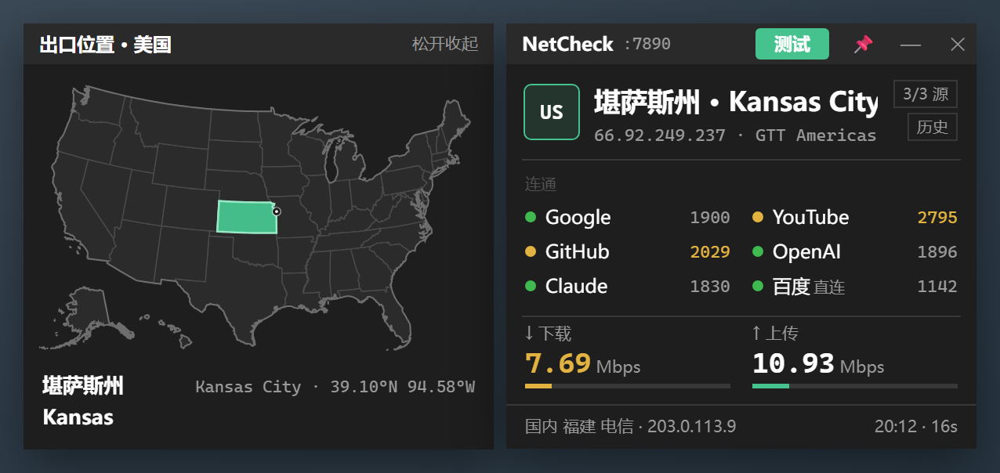

# NetCheck

一键检测你的出口 IP 在哪个城市。点一下「测试」，几秒内看到：代理通不通、出口城市（州/省 · 城市）、几个常用站点的连通性、下载/上传速度。

> A tiny Windows floating window that tells you, in one click, where your exit IP is (city-level), whether your proxy works, and how fast it is. Standard library only.

适合用代理软件（Clash、v2rayN、Shadowsocks 客户端等）、想随手确认「现在出口到底在哪、节点有没有被自动切换」的人。



> 截图取自设计稿，数据为示意。

## 功能

- **出口城市**：ip-api、ipinfo、ipwho 三个源并发查询，显示「州/省 · 城市」、IP、运营商；各源城市不一致时标「源不一致」
- **连通性**：Google、YouTube、GitHub、OpenAI、Claude 文档，外加百度作直连对照；按响应时间着色（<2s 绿、≥2s 黄、不通红）
- **测速**：Cloudflare 测速，下载、上传各约 5 秒
- **出口变了提示**：出口城市和上次不同时，顶部出现黄条
- **诊断提示**：系统代理关闭、代理端口无响应、境外全部不通、出口是中国 IP（代理没生效）
- **出口地图**：按住国家码方块，弹出地图（美国点亮所在州，其他国家点亮所在国家）
- **历史**：按住「历史」按钮，看上一次测试结果（最多保存 10 条）
- **停止**：测试中可随时点「■ 停止」，只想看出口、不想等测速时用
- **贴边收起**：把浮窗拖到屏幕左、右或上边缘松手即吸附，鼠标移开后缩成一枚小标签，显示「国家码 + 出口城市」（如「US 洛杉矶」）。鼠标在标签上停约 0.4 秒展开浮窗，单击标签直接开始测试。出口变了标签变黄，出现诊断问题（境外不通、出口是中国 IP 等）变红；测完不会自动弹出。拖离边缘恢复普通浮窗，重启后保持贴边
- 可置顶、系统托盘图标

## 下载

不想装 Python：到 [Releases](https://github.com/liuzhaowei1/netcheck/releases) 下载 `NetCheck.exe`，双击即用。exe 由 PyInstaller 打包，部分杀毒软件可能误报；不放心可按下文用源码运行或自行打包。

## 使用

需要 Windows 和 Python 3（带 tkinter；作者环境为 Python 3.10）。无第三方依赖。

```
python netcheck_app.py
```

只要命令行结果：

```
python netcheck_core.py
```

### 它测的是哪条线路

NetCheck 跟浏览器一样，读取 **Windows 系统代理**（设置 → 网络 → 代理，注册表 `ProxyServer`），流量走系统代理发出，所以测到的就是浏览器走的那条出口。

- 代理软件需要开启「系统代理」。只开 TUN 模式或只开 SOCKS 端口、不改系统代理的，NetCheck 会提示「系统代理已关闭」，测到的是直连出口。
- 没用代理的话，测到的是你本机的直连出口。
- 仅支持 Windows（读注册表、托盘图标都是 Windows 专用）。

### 打包成 exe

```
pip install pyinstaller
python -m PyInstaller --onefile --windowed --name NetCheck --icon assets/app.ico --noconfirm --clean netcheck_app.py
```

产物在 `dist/NetCheck.exe`。

## 想改成自己的

- 连通性检测的站点：`netcheck_core.py` 里的 `TARGETS`，改一行就行
- 配置保存在 `%LOCALAPPDATA%\NetCheck\config.json`（窗口位置、置顶开关、出口历史），不含任何密钥

## 开发

```
python test_logic.py      # 纯逻辑单测，不联网、不开窗口，通过输出 ALL PASS
```

### 重新生成地图数据（一般不需要）

`geodata.py` 是生成物，运行时不依赖任何东西。要重新生成：

1. 在 `tools/` 下 `npm i d3-geo@3 topojson-client@3 topojson-simplify@3`，并在 `tools/package.json` 里设 `"type": "module"`
2. 把 `states-albers-10m.json`（us-atlas）、`countries-50m.json`（world-atlas）、`countries.json`（[mledoze/countries](https://github.com/mledoze/countries) 的 `dist/countries.json`）放进 `tools/data/`
3. `node tools/build_geodata.mjs`

## 隐私

NetCheck 不收集、不上传任何数据。测试时会向上述公共服务发请求（它们会看到你的出口 IP，这正是要测的东西）。完整列表和各自的使用条款见 [NOTICE.md](NOTICE.md)。其中 ip-api.com 免费版仅限非商业使用。

## 许可

[MIT](LICENSE)。第三方数据与服务见 [NOTICE.md](NOTICE.md)。
